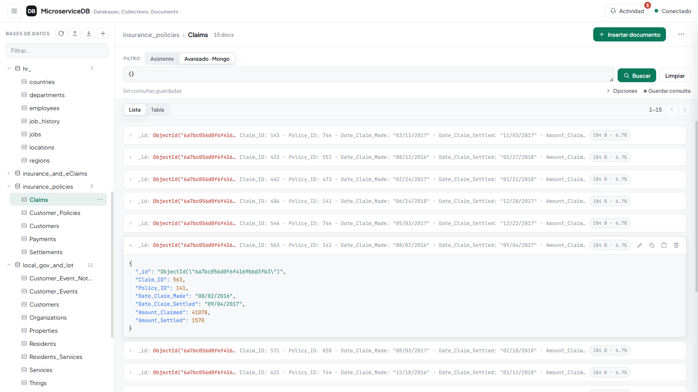
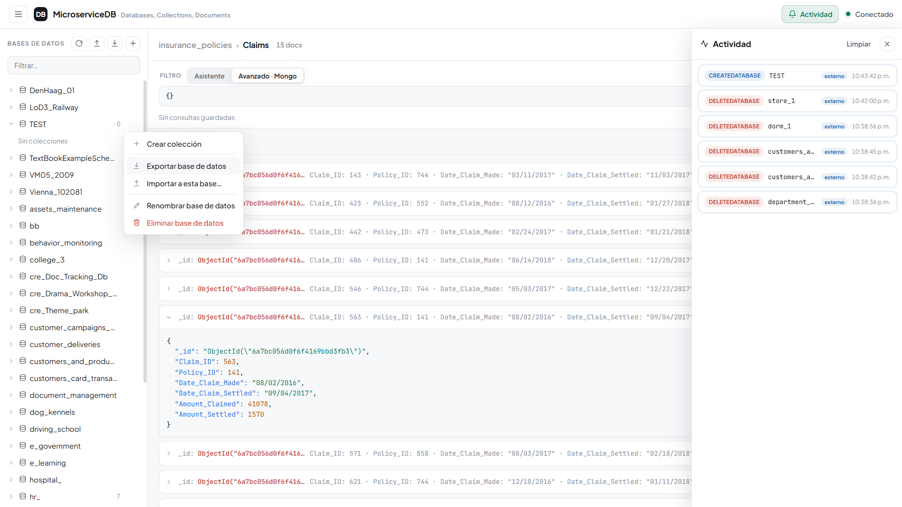
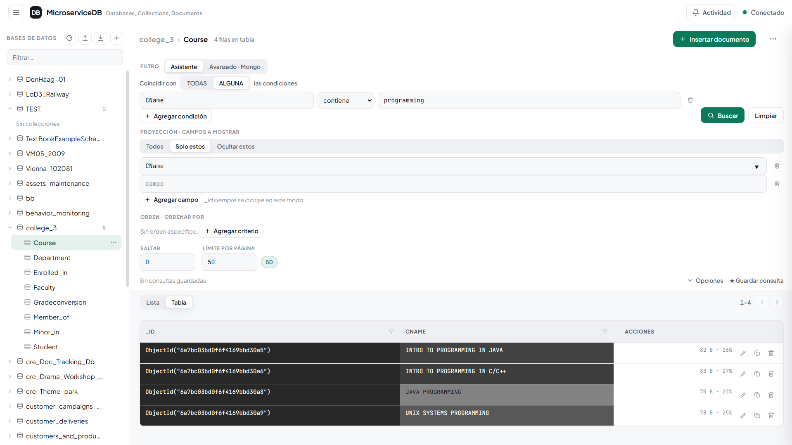
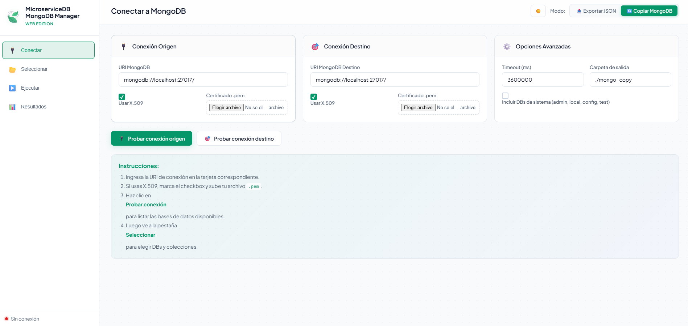
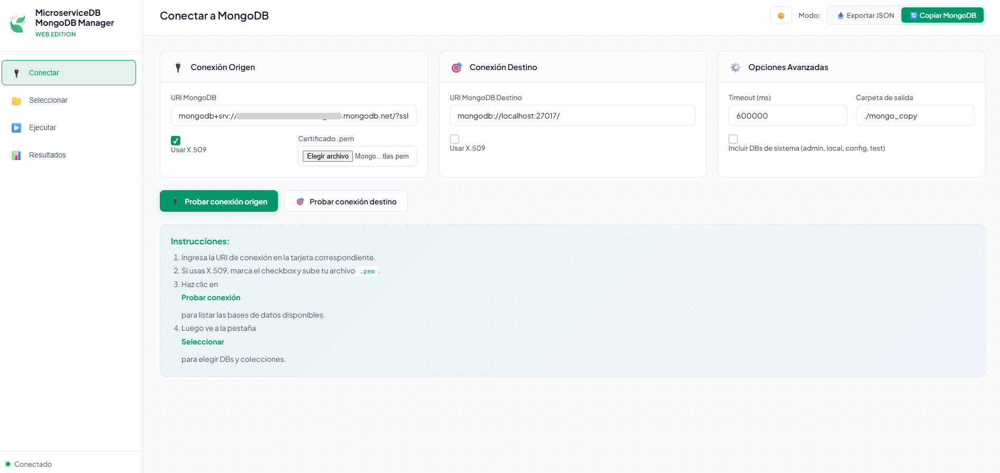
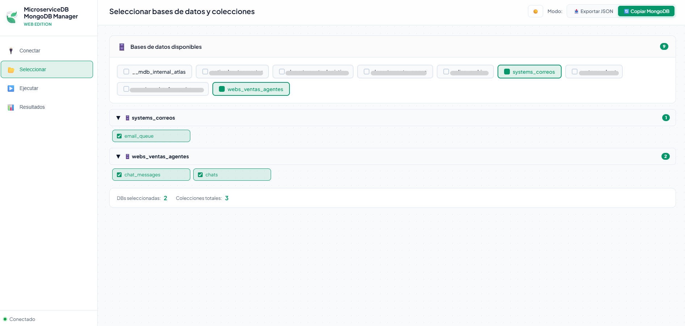
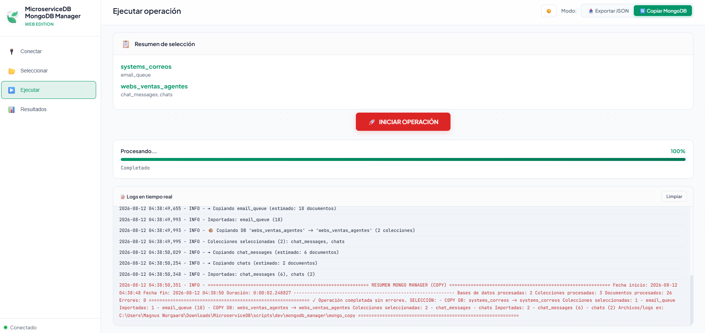
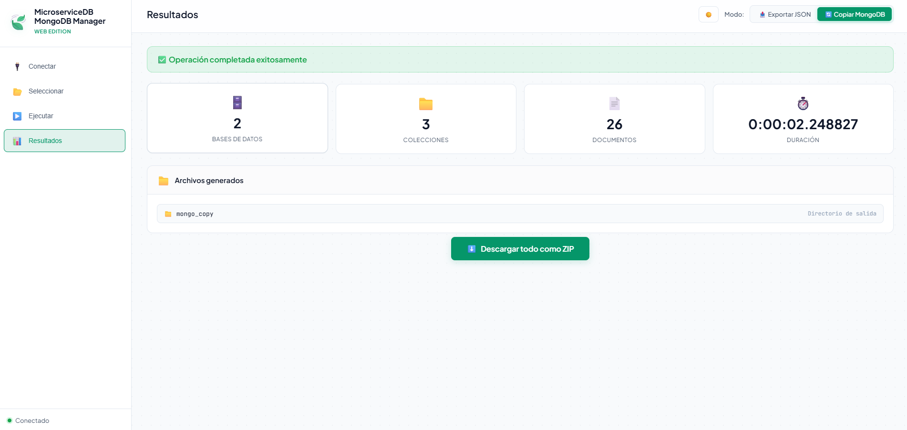
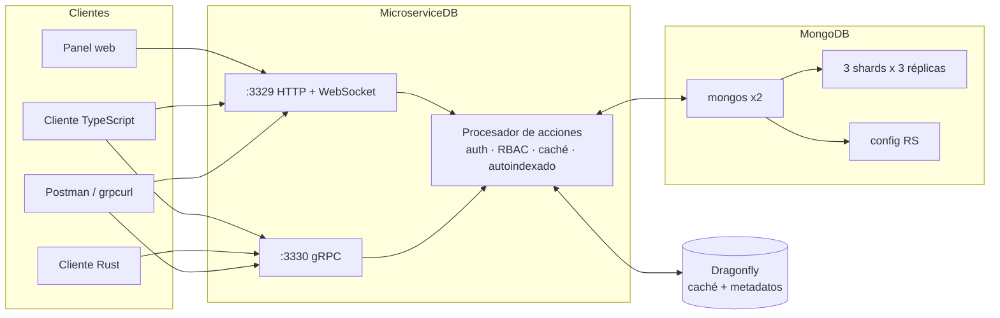

<div align="center">

<!--
  Banner opcional: coloca una imagen en docs/banner.png (o promotional_repository.png,
  como en tu repo CacheProxyComputer) y descomenta la línea de abajo.
  
-->

<h1>MicroserviceDB</h1>

<p><strong>Motor de base de datos JSON en tiempo real sobre WebSocket, con panel administrativo embebido, caché Redis/Dragonfly, auto-indexado y backups automáticos.</strong></p>

<p>
  
  
  
  
  
</p>
<p>
  
  
  
  
</p>

<p>
Servidor de base de datos JSON escrito íntegramente en <strong>Rust asíncrono</strong> (Tokio · Warp · MongoDB) que expone toda su operativa a través de un <strong>WebSocket bidireccional</strong>. Un binario único y autocontenido: el panel administrativo se sirve desde el propio ejecutable.
</p>

<p><em>Autor: <a href="https://github.com/MGNG13">Magnus Norgaard (MGNG13)</a></em></p>

</div>

<center>
  
  
  
  
  
  
  
  
</center>

Microservicio en Rust que expone MongoDB por **WebSocket** y **gRPC**, con **Dragonfly** (compatible con Redis) como única caché, **autoindexado** por uso, autenticación por **API key con roles**, **TLS** y un **panel web** de administración.

- MongoDB es la fuente de verdad: todas las escrituras son operaciones nativas confirmadas por mayoría de nodos (`w: majority` + journal).
- Dragonfly guarda solo caché (documentos y respuestas) y los metadatos del autoindexado: si se vacía, no se pierde ningún dato.
- Un mismo protocolo de acciones (`find`, `insertOne`, `createIndex`…) por WebSocket o gRPC, con clientes listos en TypeScript y Rust.

---

## Índice

1. [Arquitectura](#arquitectura)
2. [Inicio rápido con Docker](#inicio-rápido-con-docker)
3. [Ejecutar desde el código fuente](#ejecutar-desde-el-código-fuente)
4. [Conectarse con un administrador de bases de datos](#conectarse-con-un-administrador-de-bases-de-datos)
5. [Autenticación y roles](#autenticación-y-roles)
6. [TLS](#tls)
7. [Configuración](#configuración)
8. [API](#api)
9. [Índices y autoindexado](#índices-y-autoindexado)
10. [Caché](#caché)
11. [Librerías cliente](#librerías-cliente)
12. [Panel web](#panel-web)
13. [Backups](#backups)
14. [Rendimiento](#rendimiento)
15. [Solución de problemas](#solución-de-problemas)
16. [Estructura del proyecto](#estructura-del-proyecto)

---

## Arquitectura



| Puerto | Servicio |
|---|---|
| `3329` | Panel web (`/`), WebSocket (`/ws`) |
| `3330` | gRPC (`proto/microservicedb.proto`) |
| `27017`, `27020` | Routers mongos (compose) |
| `6379` | Dragonfly (compose) |

---

## Inicio rápido con Docker

Requisitos: Docker Desktop y PowerShell 7.

```powershell
.\scripts\install\docker-compose_windows.ps1
```

El instalador:

1. Genera los secretos la primera vez en `scripts/install/.env` (no lo subas al repositorio):
   `MICROSERVICEDB_ADMIN_API_KEY`, `MONGO_ADMIN_PASSWORD`, `MONGO_KEYFILE_CONTENT`, `DRAGONFLY_PASSWORD`.
2. Levanta el clúster: config RS (3 nodos), 3 shards × 3 réplicas, 2 mongos y Dragonfly, todo con autenticación (`--keyFile` en MongoDB, `--requirepass` en Dragonfly).
3. Inicializa los replica sets, crea el usuario `admin` y registra los shards.
4. Construye y arranca el contenedor `microservicedb`.

Se puede ejecutar de nuevo sin problema: detecta lo que ya está hecho.

Al terminar:

| Qué | Dónde |
|---|---|
| Panel web | http://localhost:3329/ |
| WebSocket | `ws://localhost:3329/ws` |
| gRPC | `localhost:3330` |
| API key de admin | `MICROSERVICEDB_ADMIN_API_KEY` en `scripts/install/.env` |

Comandos útiles (desde `scripts/install`):

```powershell
docker compose --profile app up -d --build microservicedb
```

```powershell
docker compose --profile app logs -f microservicedb
```

```powershell
docker compose --profile app down
```

`down -v` borra también los volúmenes (todos los datos).

---

## Ejecutar desde el código fuente

Requisitos: Rust estable. `protoc` no hace falta (se incluye con `protoc-bin-vendored`).

```powershell
cargo build --release
```

```powershell
$env:MICROSERVICEDB_MONGODB_URI = "mongodb://admin:<password>@localhost:27017/?authSource=admin"
$env:MICROSERVICEDB_DRAGONFLY_URL = "redis://:<password>@localhost:6379"
$env:MICROSERVICEDB_ADMIN_API_KEY = "<key de al menos 32 caracteres>"
.\target\release\microservice-db.exe
```

Las variables también se pueden poner en un archivo `.env` junto al ejecutable.

Generar una API key nueva (imprime la key y su SHA-256):

```powershell
.\target\release\microservice-db.exe generate-api-key
```

`scripts/build/build_windows.ps1` compila en release y copia el binario como `MicroserviceDB.exe`.

---

## Conectarse con un administrador de bases de datos

Las contraseñas están en `scripts/install/.env`.

### MongoDB (Navicat, Compass, Studio 3T, DBeaver)

| Campo | Valor |
|---|---|
| Tipo | Standalone (el mongos se comporta como un servidor único) |
| Host | `localhost` |
| Puerto | `27017` (o `27020` para el segundo mongos) |
| Autenticación | Password |
| Base de autenticación | `admin` |
| Usuario | `admin` |
| Contraseña | `MONGO_ADMIN_PASSWORD` |
| TLS | No |

Como URI:

```
mongodb://admin:<MONGO_ADMIN_PASSWORD>@localhost:27017,localhost:27020/?authSource=admin
```

Conéctate siempre a los mongos. Los puertos de los shards (`27101`…) solo ven una parte de los datos.

### Dragonfly (RedisInsight, Another Redis Desktop Manager)

| Campo | Valor |
|---|---|
| Host / puerto | `localhost:6379` |
| Usuario | vacío (o `default`) |
| Contraseña | `DRAGONFLY_PASSWORD` |
| Base | `0` |

```
redis://:<DRAGONFLY_PASSWORD>@localhost:6379/0
```

Dragonfly solo tiene caché y metadatos del autoindexado; los nombres de base y colección van codificados en hexadecimal dentro de las claves. Borrar claves no pierde datos; no las edites a mano.

---

## Autenticación y roles

Toda conexión (WebSocket, gRPC y panel) necesita una API key. Si no hay ninguna configurada, el servidor no arranca, salvo con `MICROSERVICEDB_AUTH=disabled` (solo para desarrollo local).

| Variable | Descripción |
|---|---|
| `MICROSERVICEDB_AUTH` | `required` (por defecto) o `disabled` |
| `MICROSERVICEDB_ADMIN_API_KEY` | Key de administrador en claro, mínimo 32 caracteres |
| `MICROSERVICEDB_API_KEYS_FILE` | JSON con más keys y sus roles; solo guarda el SHA-256 de cada key |

```json
{"keys": [
  {"name": "reportes",    "sha256": "<hex>", "roles": [{"role": "read",      "database": "shop"}]},
  {"name": "svc-pedidos", "sha256": "<hex>", "roles": [{"role": "readWrite", "database": "shop", "collection": "orders"}]},
  {"name": "dba-shop",    "sha256": "<hex>", "roles": [{"role": "dbAdmin",   "database": "shop"}]}
]}
```

| Rol | Permite | Alcance |
|---|---|---|
| `read` | `find`, `findOne`, `exportCollection`, `exportDatabase`, `listIndexes`, `list_collections`, eventos | base o colección (`*` = todas) |
| `readWrite` | lo anterior + `insertOne`, `updateOne`, `replaceOne`, `deleteOne`, `deleteMany`, `updateCollection`, `importCollection` | base o colección |
| `dbAdmin` | lo anterior + `createCollection`, `deleteCollection`, `renameCollection`, `importDatabase`, `createIndex` | base |
| `admin` | todo, incluido `createDatabase`, `deleteDatabase`, `renameDatabase` | global |

- `list_databases` y los eventos de cambio solo muestran lo que la key puede leer.
- Cada acceso denegado queda en el log como `auth_denied`.
- Para añadir o revocar keys hay que reiniciar el servicio.

Cómo se envía la key:

| Transporte | Forma |
|---|---|
| WebSocket | `ws://host:3329/ws?api_key=<key>` o cabecera `Authorization: Bearer <key>` / `x-api-key` |
| gRPC | metadato `authorization: Bearer <key>` o `x-api-key` |
| Panel web | la pide al abrir y la guarda solo en esa pestaña |
| Clientes TS/Rust | opción `apiKey` / `api_key` o variable `MICROSERVICEDB_API_KEY` |

---

## TLS

Con `MICROSERVICEDB_SSL_CERT` y `MICROSERVICEDB_SSL_KEY` (PEM) el panel y el WebSocket pasan a HTTPS/WSS y gRPC usa TLS con el mismo certificado. Sin certificado todo va en texto plano, incluida la API key.

Clientes:

- gRPC con TLS si la dirección empieza por `https://` o `MICROSERVICEDB_GRPC_TLS=true`.
- WebSocket seguro con `wss://` en `MICROSERVICEDB_DATABASE_WS_URL`.
- CA propia (certificados autofirmados): `MICROSERVICEDB_TLS_CA_FILE`, o `tlsCa` / `tls_ca_file`. En Node, para WSS añade `NODE_EXTRA_CA_CERTS`.

Dentro del compose, el tráfico entre nodos de MongoDB y hacia Dragonfly va por la red interna de Docker, sin TLS.

---

## Configuración

### Variables de entorno

| Variable | Por defecto | Descripción |
|---|---|---|
| `MICROSERVICEDB_MONGODB_URI` | — (obligatoria) | URI de MongoDB (standalone, replica set o mongos) |
| `MICROSERVICEDB_DRAGONFLY_URL` | — | URI de Dragonfly/Redis. Sin ella no hay caché ni autoindexado |
| `MICROSERVICEDB_PORT` | `3329` | Puerto HTTP/WebSocket |
| `MICROSERVICEDB_GRPC_PORT` | `PORT + 1` | Puerto gRPC |
| `MICROSERVICEDB_PROFILE` | `production` | `production`, `local`, `dev` (ver abajo) |
| `MICROSERVICEDB_LOG_LEVEL` | según perfil | `error`, `warn`, `info`, `debug`, `trace` |
| `MICROSERVICEDB_MONGODB_CONNECT_TIMEOUT_SECS` | según perfil | Timeout de conexión |
| `MICROSERVICEDB_MONGODB_SERVER_SELECTION_TIMEOUT_SECS` | según perfil | Timeout de selección de servidor |
| `MICROSERVICEDB_MONGODB_MAX_POOL_SIZE` | según perfil | Conexiones máximas a MongoDB |
| `MICROSERVICEDB_MONGODB_WRITE_CONCERN` | `majority` | `majority` o número de nodos |
| `MICROSERVICEDB_MONGODB_JOURNAL` | `true` | Exigir journal en cada escritura |
| `REQUEST_CACHE_TTL_SECS` | `300` | Vida de la caché de respuestas |
| `DOC_CACHE_TTL_SECS` | `300` | Vida de la caché de documentos |
| `MICROSERVICEDB_AUTOINDEX_THRESHOLD` | `50` | Consultas sobre un campo para crear su índice |
| `MICROSERVICEDB_AUTOINDEX_WINDOW_SECS` | `600` | Ventana en la que se cuentan esas consultas |
| `MICROSERVICEDB_AUTOINDEX_DROP_IDLE_SECS` | `86400` | Un autoíndice sin uso este tiempo se borra |
| `MICROSERVICEDB_AUTOINDEX_REVIEW_SECS` | `600` | Cada cuánto se revisan los autoíndices (mín. 60) |
| `MICROSERVICEDB_AUTOINDEX_MIN_DOCS` | `1000` | Colecciones más pequeñas no reciben autoíndices |
| `MICROSERVICEDB_AUTOINDEX_SAMPLE_SIZE` | `1000` | Documentos muestreados para medir selectividad |
| `MICROSERVICEDB_AUTOINDEX_MAX_MATCH_RATIO` | `0.10` | Fracción máxima de la colección que puede devolver una igualdad para que el índice valga la pena |
| `MICROSERVICEDB_BACKUP_DIR` | — | Carpeta de backups (necesaria con `--backup`) |
| `MICROSERVICEDB_BACKUP_INTERVAL_MINS` | `30` | Intervalo de backups |
| `MICROSERVICEDB_SSL_CERT` / `MICROSERVICEDB_SSL_KEY` | — | Certificado y llave PEM (activan TLS) |
| `MICROSERVICEDB_AUTH`, `MICROSERVICEDB_ADMIN_API_KEY`, `MICROSERVICEDB_API_KEYS_FILE` | — | Ver [Autenticación](#autenticación-y-roles) |

### Perfiles

| Perfil | Timeout conexión | Timeout selección | Pool | Log |
|---|---|---|---|---|
| `production` (por defecto) | 300 s | 300 s | 20 | `info` |
| `local` | 30 s | 15 s | 10 | `debug` |
| `dev` | 10 s | 5 s | 5 | `trace` |

Cualquier variable explícita tiene prioridad sobre el perfil.

### Argumentos

| Argumento | Descripción |
|---|---|
| `--port <n>` o primer argumento numérico | Puerto HTTP/WebSocket |
| `--backup [true\|false]` | Activa el agente de backups |
| `generate-api-key` | Imprime una key nueva y su SHA-256, y sale |

---

## API

El WebSocket y gRPC aceptan las mismas peticiones y dan las mismas respuestas.

### WebSocket

Un mensaje JSON por petición; las respuestas llegan en el mismo orden.

```json
{
  "type": "action",
  "category": "collection",
  "function_name": "find",
  "payload": {
    "database_name": "shop",
    "collectionName": "items",
    "filter": { "price": { "$gte": 10 } },
    "projection": { "data": 0 },
    "sort": { "price": -1 },
    "skip": 0,
    "limit": 50
  }
}
```

Respuesta:

```json
{ "success": true, "response_json": "[...]", "message": "OK" }
```

`response_json` es texto JSON. Si `success` es `false`, el error está en `message`.

Los cambios de otros clientes llegan solos al mismo socket con `"kind": "change"` (campos `event`, `database_name`, `collectionName`, `before`, `after`, `summary`, `ts`), filtrados por lo que la key puede leer.

### Tipos de petición

| `type` | Uso |
|---|---|
| `action` | Operación; requiere `category` y `function_name` |
| `metadata` | Funciones y eventos disponibles |
| `list_databases` | Bases visibles para la key |
| `list_collections` | Colecciones de `database_name` |
| `precache` | Precarga en caché las `collections` de `database_name` |

### Funciones de colección (`category: "collection"`)

Todas llevan `database_name` y `collectionName` en el `payload`.

| Función | Payload | Respuesta |
|---|---|---|
| `find` | `filter`, `projection`, `sort`, `skip`, `limit` | lista de documentos |
| `findOne` | `filter` (o `query`), `projection`, `sort` | documento o `null` |
| `insertOne` | `document` | `insertedId` (se genera un ObjectId si falta `_id`) |
| `updateOne` | `filter`, `update` (`$set`, `$inc`, `$setOnInsert`…), `options.upsert` | `matchedCount`, `modifiedCount`, `upsertedId` |
| `replaceOne` | `filter`, `replacement`, `options.upsert` | igual que `updateOne` |
| `deleteOne` | `filter` | `deletedCount` |
| `deleteMany` | `filter` | `deletedCount` |
| `updateCollection` | `data` (upsert por `_id`) o `filter` + `update` | `insertedCount` / `matchedCount`, `modifiedCount` |
| `exportCollection` | — | todos los documentos |
| `importCollection` | `data`, `mode`: `merge` (por defecto), `append`, `replace` | `insertedCount`, `modifiedCount` |
| `listIndexes` | — | `indexes` (ver [Índices](#índices-y-autoindexado)) |
| `createIndex` | `keys: [{field, type}]`, `options` | `name`, `replacedAutoIndex` |

Los filtros aceptan la sintaxis de MongoDB (`$and`, `$or`, `$nor`, `$not`, `$in`, `$regex` con `$options`, `$exists`, campos anidados con punto…). Un `_id` enviado como texto también encuentra el ObjectId equivalente.

### Funciones de base de datos (`category: "database"`)

| Función | Payload |
|---|---|
| `createDatabase` | `database_name` |
| `deleteDatabase` | `database_name` |
| `renameDatabase` | `database_name`, `new_database_name` |
| `createCollection` | `database_name`, `collectionName` |
| `deleteCollection` | `database_name`, `collectionName` |
| `renameCollection` | `database_name`, `collectionName`, `new_collection_name` |
| `exportDatabase` | `database_name` |
| `importDatabase` | `database_name`, `data` (`{colección: [docs]}`), `mode`: `replace` (por defecto) o `merge` |

### gRPC

Servicio `microservicedb.DatabaseService` en `proto/microservicedb.proto`:

| Método | Uso |
|---|---|
| `Action` | Cualquier petición anterior: `msg_type`, `category`, `function_name` y `payload_json` (el payload como texto JSON) |
| `StreamChanges` | Flujo de eventos; filtros `database_name`, `collection_name`, `include_system` |
| `ExportCollectionStream` | Exporta una colección por lotes (`batch_size`, `filter_json`); envía el primer lote sin esperar al resto |

El servidor no tiene reflection, así que `grpcurl` y Postman necesitan el `.proto`:

```powershell
grpcurl -plaintext -import-path proto -proto microservicedb.proto -H "authorization: Bearer $env:KEY" -d '{\"category\":\"collection\",\"function_name\":\"findOne\",\"payload_json\":\"{\\\"database_name\\\":\\\"shop\\\",\\\"collectionName\\\":\\\"items\\\",\\\"filter\\\":{}}\"}' localhost:3330 microservicedb.DatabaseService/Action
```

### Postman

- **WebSocket:** New → WebSocket, URL `ws://localhost:3329/ws`, cabecera `x-api-key`, mensajes de texto con el JSON de arriba.
- **gRPC:** New → gRPC, URL `localhost:3330`, importa `proto/microservicedb.proto`, metadato `authorization: Bearer <key>`.

---

## Índices y autoindexado

Los índices viven **solo en MongoDB**. Dragonfly guarda caché y los contadores del autoindexado, no índices sobre los datos.

| Tipo | Quién lo crea | Quién lo borra |
|---|---|---|
| `_id_` | MongoDB | nadie |
| Manual | `createIndex` o el panel | nadie desde el servicio; el autoindexado nunca los toca |
| Automático `mdb_auto_<campo>` | el autoindexado | el autoindexado |

**Cómo funciona el autoindexado:**

1. Cada consulta suma uso a los campos de su filtro.
2. Cuando un campo pasa `AUTOINDEX_THRESHOLD` consultas en la ventana, se mide su selectividad con una muestra; si una igualdad devolvería más de `AUTOINDEX_MAX_MATCH_RATIO` de la colección, o la colección tiene menos de `AUTOINDEX_MIN_DOCS` documentos, no se crea.
3. En cada revisión se borran los autoíndices sin uso durante `AUTOINDEX_DROP_IDLE_SECS`, los que dejaron de ser eficientes y los huérfanos.
4. Si ya existe un índice manual sobre ese campo, el autoindexado lo usa pero nunca lo borra.

**Crear un índice manual:**

```json
{
  "type": "action", "category": "collection", "function_name": "createIndex",
  "payload": {
    "database_name": "shop", "collectionName": "items",
    "keys": [{ "field": "cliente.id", "type": 1 }, { "field": "price", "type": -1 }],
    "options": { "name": "cliente_price", "unique": false, "sparse": false,
                 "expireAfterSeconds": null, "partialFilterExpression": null }
  }
}
```

- `type`: `1`, `-1`, `"text"`, `"hashed"`, `"2dsphere"`, `"2d"`.
- `keys` es una lista porque el orden importa en los índices compuestos.
- Los nombres que empiezan por `mdb_auto_` están reservados.
- Si ya hay un autoíndice con las mismas claves, el manual lo sustituye (MongoDB no permite dos índices con las mismas claves).

---

## Caché

| Caché | Qué guarda | Se llena | Se vacía |
|---|---|---|---|
| Documentos | cada documento por `_id` | al insertar o actualizar (write-through) y al leer | al borrar, o al pasar `DOC_CACHE_TTL_SECS` |
| Respuestas | la respuesta completa de `find`, `findOne`, exportaciones y listados | en la primera petición | en cualquier escritura sobre esa base, o al pasar `REQUEST_CACHE_TTL_SECS` |

Las búsquedas por `_id` exacto se resuelven en la caché de documentos; el resto de consultas van a MongoDB con filtro, orden, `skip` y `limit` del lado del servidor.

---

## Librerías cliente

### TypeScript (`lib/typescript`)

```powershell
cd lib/typescript
npm install
npm run build
```

```ts
import MicroserviceDBAPI from './MicroserviceDBAPI';

const db = new MicroserviceDBAPI('shop', [], {
    transport: 'grpc',            // o 'websocket' (por defecto)
    grpcAddress: 'localhost:3330',
    apiKey: process.env.MICROSERVICEDB_API_KEY,
});

await db.insertOne('items', { sku: 'A-1', price: 5 });
const items = await db.find('items', { price: { $gte: 5 } });
const one = await db.findOne('items', { sku: 'A-1' });
await db.updateOne('items', { sku: 'A-1' }, { $inc: { price: 1 } });
await db.deleteOne('items', { sku: 'A-1' });

const unsubscribe = db.subscribe((ev) => console.log(ev.event, ev.collectionName));
await db.exportCollectionStream('items', (batch) => console.log(batch.sent, '/', batch.total)); // solo gRPC
db.close();
```

Variables: `MICROSERVICEDB_TRANSPORT`, `MICROSERVICEDB_API_KEY`, `MICROSERVICEDB_DATABASE_WS_URL`, `MICROSERVICEDB_DATABASE_GRPC_ADDRESS`, `MICROSERVICEDB_GRPC_TLS`, `MICROSERVICEDB_TLS_CA_FILE`.

### Rust (`lib/rust/MicroserviceDBAPI.rs`)

Dependencias del crate que lo use: `tokio` (full), `futures-util`, `serde` (derive), `serde_json`, `tokio-tungstenite`, `tonic = { version = "0.12", features = ["tls", "tls-native-roots"] }`, `prost = "0.13"`.

```rust
let opts = ClientOptions {
    transport: Transport::Grpc,
    grpc_address: Some("localhost:3330".into()),
    api_key: Some(key),
    tls_ca_file: None,
};
let db = MicroserviceDBAPI::with_options("shop", &[], opts);
db.insert_one("items", json!({ "sku": "A-1" })).await?;
let items = db.find("items", Some(json!({ "sku": "A-1" })), None).await?;
db.close().await;
```

---

## Panel web

En http://localhost:3329/ (pide la API key al abrir):

- Árbol de bases y colecciones con filtro; se actualiza con **Refrescar** y con los eventos de otros clientes.
- Consultas con constructor visual o JSON, proyección, orden, paginación, vista de lista y tabla.
- Insertar, editar, clonar y borrar documentos; importar y exportar colecciones.
- **Índices** (botón en la cabecera de la colección): manuales y de sistema marcados como no borrables, automáticos con su uso y fecha de retiro, y formulario para crear índices.
- **Actividad**: los cambios en tiempo real, con el documento antes y después.

---

## Backups

```powershell
$env:MICROSERVICEDB_BACKUP_DIR = "D:\backups\microservicedb"
.\target\release\microservice-db.exe --backup
```

Cada `MICROSERVICEDB_BACKUP_INTERVAL_MINS` exporta cada base a un archivo 7z (si `7z` está en el PATH; la imagen Docker lo incluye) o gzip. Los backups no van cifrados.

---

## Rendimiento

Referencia medida en un portátil (Intel Core Ultra 7 155U, 16 GB) con el compose completo, archivos binarios guardados como base64 y escritura por mayoría. Todo corre en la misma máquina, así que las cifras sirven para comparar operaciones, no como capacidad de producción.

| Operación | p50 |
|---|---|
| Insertar archivo de 10 KB / 1 MB / 4 MB | 33 ms / 193 ms / 1,2 s |
| Leer 100 KB por `_id`: MongoDB / caché de documentos / caché de respuestas | 23 / 11 / 8 ms |
| Consulta de 20 archivos con base64 / sin base64 (proyección) | 356 / 98 ms |
| Rendimiento máximo (mezcla 70 % lectura / 30 % escritura, archivos de 20 KB) | ~80 ops/s con 8 usuarios |

Recomendaciones que salen de esas pruebas:

- En listados, excluye el contenido pesado (`projection: { data: 0 }`) y descarga cada archivo por `_id`.
- Para importar, usa lotes de unos 250 documentos.
- Para exportaciones grandes, usa `ExportCollectionStream` (gRPC): entrega el primer lote en milisegundos en lugar de esperar la respuesta completa.

---

## Solución de problemas

| Síntoma | Causa probable |
|---|---|
| El servidor no arranca: «Authentication is required but no API keys are configured» | Falta `MICROSERVICEDB_ADMIN_API_KEY` o `MICROSERVICEDB_API_KEYS_FILE` |
| El WebSocket devuelve 401 | Falta la key o es inválida |
| gRPC `UNAUTHENTICATED` | Falta el metadato `authorization` |
| gRPC `UNAVAILABLE` contra un servidor con TLS | El cliente se conecta sin TLS: usa `https://` o `MICROSERVICEDB_GRPC_TLS=true` |
| `Permission denied: … requires role …` | La key es válida pero su rol no permite esa operación |
| Navicat/Compass: «Authentication failed» | Falta la base de autenticación `admin` |
| Redis: `NOAUTH Authentication required` | Falta la contraseña `DRAGONFLY_PASSWORD` |
| Un cambio en `MicroserviceDB.html` no aparece en el panel | El HTML va dentro del binario: recompila (o reconstruye la imagen con `docker compose --profile app up -d --build microservicedb`) |

---

## Estructura del proyecto

```
.
├── src/
│   ├── main.rs              # servidor: WebSocket, gRPC, acciones, caché, autoindexado, backups
│   └── auth.rs              # API keys y roles
├── proto/microservicedb.proto
├── MicroserviceDB.html      # panel web (se incrusta en el binario)
├── lib/
│   ├── typescript/          # cliente TS (WebSocket + gRPC)
│   └── rust/                # cliente Rust (WebSocket + gRPC)
├── scripts/
│   ├── install/             # docker-compose.yml + instalador de Windows
│   ├── build/               # build de release en Windows
│   └── dev/mongodb_manager/ # herramienta web para exportar/copiar bases MongoDB
├── Dockerfile
└── build.rs                 # genera el código gRPC desde el .proto
```

<div align="center">

Hecho por **[Magnus Norgaard (MGNG13)](https://github.com/MGNG13)** · Full-Stack Developer

<sub>Si este proyecto te resulta útil, considera dejar una ⭐ en el repositorio.</sub>

</div>
